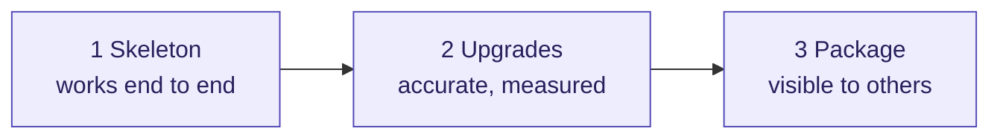
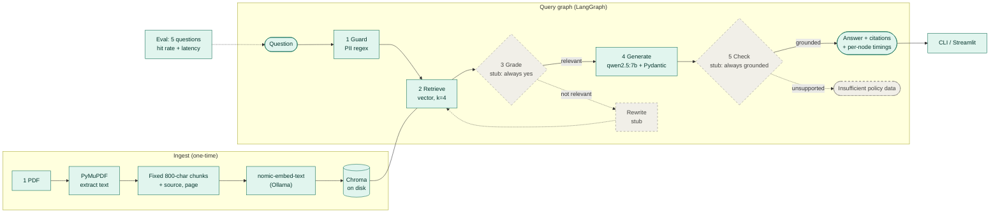
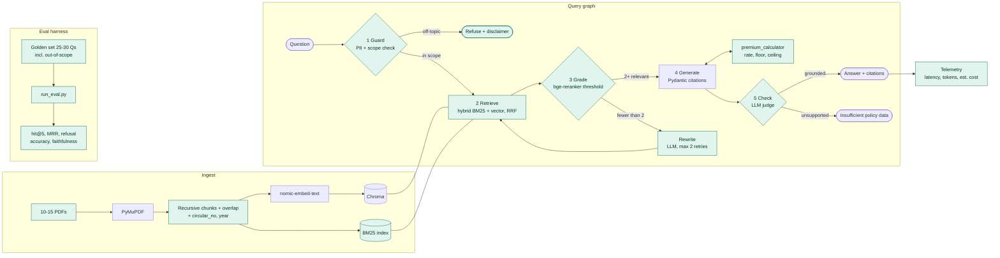
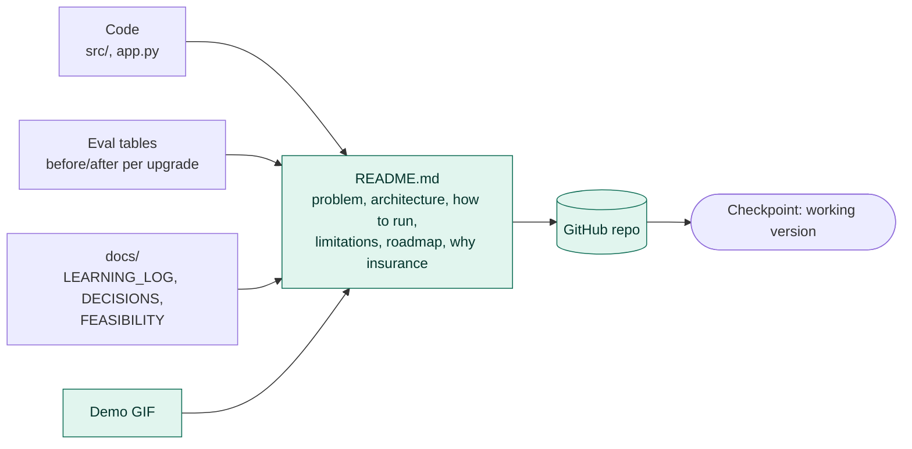

# PhilHealth Policy & Benefits RAG Agent: Phase 1 Plan (Stages 1–3)

## Context
A portfolio project in the insurance domain: an assistant that answers PhilHealth benefit and policy questions with verified citations. The approach is to **build a thin end-to-end working version first** to see how all the pieces connect and confirm it's feasible, then **upgrade one piece at a time** while learning each concept hands-on.

**Phase 1 scope:** Stages 1–3, running entirely locally:
1. Walking skeleton: one question flows through every node.
2. Upgrade loop: replace each stub with a real component and measure every change.
3. Package: a README that lets anyone run and verify it.

Phase 2 (MCP server, observability, Bedrock, deployment and CI/CD) is planned separately and starts only once Phase 1 is complete.

Constraints:
- Low cost and local first (M1, 16 GB RAM, Python 3.12, Ollama).
- Kept easy to move to AWS Bedrock in Phase 2: all model access goes through `src/config.py`.
- A credible weekend deliverable.

Workspace: `insurance_policy_assistant/`.

## Target architecture (what the skeleton wires up from day one)
```
Query → [1 PII/Scope Guard] → [2 Retriever] → [3 Relevance Grader] ─NO(<2)→ [Rewrite] → back to 2
                                                  │YES
                                                  ▼
                              [4 Citation Generator (Pydantic)] → [5 Grounding Check]
                                                  │GROUNDED                │UNSUPPORTED
                                                  ▼                        ▼
                                     Answer + citations          "Insufficient policy data to confirm."
                                              + telemetry (latency/tokens per node)
```

### Progression overview
**Diagram legend (all stage diagrams):** green = new in that stage · grey dashed = stub (placeholder) · plain = unchanged from earlier stages.



| Stage | Input | Output | Question it answers |
|---|---|---|---|
| 1 Walking skeleton | 1 small PDF, a question | CLI + Streamlit answer with citations and per-node timings; tag `v0.1-skeleton` | Does it work at all? |
| 2 Upgrade loop | Working skeleton, golden set | One commit per upgrade with before/after eval numbers; tag `v0.2` | Is it accurate? |
| 3 Package | Stage 2 results, docs/ notes | README on GitHub | Checkpoint: does it run end to end from the README? |

## Stack: local first
| Layer | Phase 1 (local, free) | Phase 2 option |
|---|---|---|
| LLM | Ollama `qwen2.5:7b` | Claude Haiku on Bedrock |
| Embeddings | Ollama `nomic-embed-text` | Titan Embed v2 |
| Vector store | Chroma (on disk) | OpenSearch Serverless / Bedrock KB |
| Orchestration | LangGraph | same |
| UI | Streamlit | App Runner / EC2 |

`src/config.py` is the only file that knows the provider: `get_llm()` and `get_embeddings()` read `config.yaml`.

## Key concepts (glossary)
- **LLM (Large Language Model):** predicts text. It doesn't know your documents, and when unsure it can **hallucinate** (invent a confident answer).
- **RAG (Retrieval-Augmented Generation):** look up relevant document excerpts first, paste them into the prompt, and tell the LLM to answer only from them and cite them. An open-book exam instead of answering from memory.
- **Ollama:** runs LLMs locally on the Mac. `qwen2.5:7b` (7 billion parameters) fits in 16 GB. Like a local simulator before flashing real hardware (Bedrock).
- **Embedding:** converts text into a vector (`nomic-embed-text` gives 768 floats) that captures meaning. Similar meanings produce nearby vectors, even with no shared words.
- **Chunk:** a piece of a document (about 800 characters) with metadata such as `{source, page}`. The metadata is what makes citations possible.
- **Ingest:** the one-time pipeline: PDF → text → chunks → embeddings → vector store.
- **Chroma:** a vector database. It answers "find the k chunks closest in meaning to this question." Saved on disk.
- **Retrieve, k=4:** embed the question and fetch the 4 nearest chunks.
- **PII (Personally Identifiable Information):** data that identifies a person, e.g. a 12-digit PhilHealth ID. It must not reach the LLM.
- **Regex:** a pattern-matching expression, e.g. `\b\d{12}\b` for 12 digits.
- **Pydantic:** a Python library for typed, validated data shapes (like a C `struct` with runtime type checks).
- **Structured output:** `with_structured_output(Answer)` forces the LLM to return JSON matching the Pydantic model instead of free text.
- **LangGraph:** builds the pipeline as a state machine. **State** = a shared dict (context struct); **node** = `function(state) -> updates`; **edge** = transition; **conditional edge** = branch.
- **Stub:** a placeholder returning a fixed value (like a mocked HAL function). It is replaced later without changing the graph.
- **Eval / golden set:** test questions with known correct pages; the regression suite for answer quality.
- **Token:** the unit an LLM reads and writes (about ¾ of a word). Cloud providers bill per token.

## Project layout
```
insurance_policy_assistant/
  config.yaml  requirements.txt  .env.example  .gitignore  README.md
  src/config.py  src/ingest.py  src/retriever.py  src/schemas.py
  src/nodes/{guard,retrieve,grade,rewrite,generate,check}.py
  src/graph.py         # LangGraph wiring + telemetry
  app.py               # Streamlit
  eval/golden_set.jsonl  eval/run_eval.py
  tests/test_nodes.py  # unit tests (Stage 1 step 6, reused by CI in Phase 2)
  data/raw/  data/chroma/
```
Each node is a plain function `node(state) -> dict`. Upgrading a node means changing one file; the graph stays the same.

Tip: put the Chroma path in `config.yaml` per provider from the start (e.g. `data/chroma/ollama/`), so local and Bedrock vector stores never get mixed up when switching to Bedrock in Phase 2. (Already done: `data/chroma/ollama/`.)

---

## Stage 1: Walking skeleton (Sat morning, ~4 h). Goal: one question flows through every node
**Learn as you go:** what RAG is, embeddings, what a LangGraph state/node/edge is, structured output.

| Node | Skeleton version (simplest thing that works) |
|---|---|
| Setup | `brew install ollama`, `ollama pull qwen2.5:7b nomic-embed-text`, venv, `pip install langchain langchain-ollama langchain-chroma langgraph chromadb pymupdf streamlit pydantic pyyaml` |
| Data | **1 small PDF only** (e.g. the latest premium contribution circular, ~5–15 pages, with a text layer). Questions are written against this one doc. Only after the skeleton works, add a 2nd doc to test multi-source citations. |
| Ingest | PyMuPDF → fixed 800-char chunks → Chroma, metadata `{source, page}` |
| 1 Guard | One regex that masks 12-digit PhilHealth IDs. No scope check yet. |
| 2 Retrieve | Vector search, k=4 |
| 3 Grade | **Stub:** always returns "relevant" (the edge to Rewrite exists but is never taken) |
| Rewrite | **Stub:** returns the query unchanged, increments `retries` |
| 4 Generate | Real LLM call with `with_structured_output(Answer)`, where `Answer = {answer, citations:[{source,page,quote}]}` |
| 5 Check | **Stub:** always returns "grounded" (the fallback edge exists) |
| Telemetry | `time.perf_counter()` around each node, stored in `state["timings"]` |
| Interface | CLI first (`python -m src.graph "question"`), then a 30-line Streamlit page that shows the answer, citations and timings |
| Eval | `run_eval.py` with **5 questions about that one PDF** (4 answerable, 1 not in the doc); prints whether the expected page was retrieved, plus total latency |
| Notes | Start `docs/LEARNING_LOG.md` (see "Documenting as you go" below) |

**Done when:** 5 questions run end to end, the Streamlit page shows cited answers and per-node timings, and the work is committed and tagged `v0.1-skeleton`.

**Feasibility read-out (write it in the README):** latency per node on the M1, whether the 7B model returns valid Pydantic output reliably, and the retrieval hit rate on 5 questions. This tells you where to spend the rest of the weekend.

### Stage 1 details

**Input:** 1 PDF and a question. **Output:** a Pydantic answer with citations and per-node timings (CLI and Streamlit), a 5-question eval printout, and `docs/FEASIBILITY.md`.



**Build order.** Each step is testable before the next one depends on it. Don't move to the next step until the test passes. Run the commands from the project root with the venv active.

| # | Step | How to test | Pass when |
|---|---|---|---|
| 1 | Install Ollama, pull the two models (one `ollama pull` per model) | `curl http://localhost:11434`<br>`ollama list`<br>`ollama run qwen2.5:7b "Reply with OK"` | Prints `Ollama is running`; both `qwen2.5:7b` and `nomic-embed-text` are listed; the model replies |
| 2 | `config.py` + `config.yaml` | `python -c "from src.config import get_llm, get_embeddings; print(get_llm().invoke('Say hi').content); print(len(get_embeddings().embed_query('test')))"` | Prints a short reply, then `768` (the vector size) |
| 3 | `ingest.py` | `python -m src.ingest`, then<br>`python -c "import chromadb; c = chromadb.PersistentClient('data/chroma/ollama'); print(c.get_collection("philhealth").count())"` | Both print the same chunk count (N). Delete the folder and re-run ingest: still N, not 2N |
| 4 | `retriever.py` (e.g. `search(query, k=4)`) | `python -c "from src.retriever import search; [print(d.metadata, d.page_content[:80]) for d in search('premium contribution rate')]"` | 4 results, each with `source` and `page`. Open the PDF at one of those pages and confirm the text is really there |
| 5 | `schemas.py` (Pydantic) | `python -c "from src.schemas import Answer; print(Answer.model_validate({'answer': 'x', 'citations': [{'source': 'a.pdf', 'page': 1, 'quote': 'q'}]}))"`<br>Then repeat with `'page': 'abc'` | The first prints an `Answer` object; the second raises `ValidationError` |
| 6 | The 6 nodes | `pytest tests/test_nodes.py -v`, with tests such as:<br>`guard({"query": "ID 123456789012"})["query"] == "ID [REDACTED]"`<br>`grade({})["relevant"] is True`<br>`rewrite({"retries": 0})["retries"] == 1`<br>`check({})["grounded"] is True`<br>`generate(state with 1 fake chunk)` returns a dict with `answer` and `citations` | All tests pass |
| 7 | `graph.py` | `python -m src.graph "What is the premium contribution rate?"`<br>`python -m src.graph "My ID is 123456789012. What is the premium rate?"` | Prints an answer, at least 1 citation with `source` and `page`, and a timing for every node. In the second run the query shows `[REDACTED]` |
| 8 | `app.py` (Streamlit) | `streamlit run app.py`, open `http://localhost:8501`, ask the same question as in step 7 | Same answer, citations and timings as the CLI |
| 9 | `run_eval.py` + 5 questions | `python eval/run_eval.py` | 5 rows, each with a hit (✓/✗) and latency, plus a total hit rate. Spot-check 1 hit by opening the cited page |
| 10 | Commit, tag `v0.1-skeleton`, write FEASIBILITY.md | `git status`, `git tag`, open `docs/FEASIBILITY.md` | Working tree clean; `v0.1-skeleton` listed; latency per node, Pydantic success rate and hit rate all filled in |

**Ingest dry run** (a page with 2,000 characters):

| Stage | Data |
|---|---|
| PyMuPDF | `page_index=1` → `text="Konsulta is a primary care package..."` (2,000 chars) |
| Chunk (800) | `c0 = text[0:800]`, `c1 = text[800:1600]`, `c2 = text[1600:2000]` |
| Metadata | `{source: "circular.pdf", page: 2}` (`page_index + 1`, since PyMuPDF counts from 0) |
| Embed | `c0` → `[0.021, -0.113, …]`, 768 floats |
| Chroma stores | `id, vector, text, metadata` × 3 |

```python
import pymupdf
from langchain_chroma import Chroma
from src.config import get_embeddings

doc = pymupdf.open("data/raw/circular.pdf")
texts, metas = [], []
for i, page in enumerate(doc):
    t = page.get_text()
    for start in range(0, len(t), 800):
        texts.append(t[start:start+800])
        metas.append({"source": "circular.pdf", "page": i + 1})

vs = Chroma("policies", embedding_function=get_embeddings(),
            persist_directory="data/chroma/ollama")
vs.add_texts(texts, metadatas=metas)
print(len(texts), "chunks")
```
Ingest runs once per document. Questions never re-read the PDF.

**State and graph.**
```python
from typing import TypedDict, Annotated
from langgraph.graph import StateGraph, START, END

def merge(a: dict, b: dict) -> dict:
    return {**a, **b}

class State(TypedDict, total=False):
    query: str
    chunks: list          # retrieved Documents
    relevant: bool
    retries: int
    answer: dict          # Answer.model_dump()
    grounded: bool
    timings: Annotated[dict, merge]   # reducer: merge, don't overwrite

g = StateGraph(State)
for name, fn in [("guard", guard), ("retrieve", retrieve), ("grade", grade),
                 ("rewrite", rewrite), ("generate", generate), ("check", check),
                 ("fallback", fallback)]:
    g.add_node(name, fn)
g.add_edge(START, "guard")
g.add_edge("guard", "retrieve")
g.add_edge("retrieve", "grade")
g.add_conditional_edges("grade",
    lambda s: "generate" if s["relevant"] or s["retries"] >= 2 else "rewrite")
g.add_edge("rewrite", "retrieve")
g.add_edge("generate", "check")
g.add_conditional_edges("check", lambda s: END if s["grounded"] else "fallback")
g.add_edge("fallback", END)
app = g.compile()
```
A node returns *updates*, not the whole state, and LangGraph overwrites a key by default. Without the `merge` reducer, each node's `{"timings": {...}}` would wipe out the previous node's timing.

**Nodes (skeleton versions).**
```python
import re, time

def guard(s):
    t = time.perf_counter()
    q = re.sub(r"\b\d{12}\b", "[REDACTED]", s["query"])
    return {"query": q, "timings": {"guard": time.perf_counter() - t}}

def retrieve(s):
    docs = vs.similarity_search(s["query"], k=4)
    return {"chunks": docs}                                  # + timing

def grade(s):    return {"relevant": True}                   # stub
def rewrite(s):  return {"retries": s.get("retries", 0) + 1} # stub
def check(s):    return {"grounded": True}                   # stub
def fallback(s): return {"answer": {"answer": "Insufficient policy data to confirm.", "citations": []}}
```

**Generate: the one real LLM call.**
```python
from pydantic import BaseModel

class Citation(BaseModel):
    source: str
    page: int
    quote: str

class Answer(BaseModel):
    answer: str
    citations: list[Citation]

llm = get_llm().with_structured_output(Answer)   # temperature=0 set in get_llm()

def generate(s):
    context = "\n\n".join(
        f"[{d.metadata['source']} p.{d.metadata['page']}]\n{d.page_content}"
        for d in s["chunks"])
    prompt = f"""Answer ONLY from the excerpts below. Cite source and page.
Excerpts:
{context}

Question: {s['query']}"""
    return {"answer": llm.invoke(prompt).model_dump()}
```
What can go wrong (and what the feasibility check counts): malformed JSON raises a validation error, a cited page wasn't in the excerpts, or the `quote` doesn't appear in the chunk.

**Dry run: one question through the graph.** Question: *"What does Konsulta cover? My ID is 123456789012"*. Timings are filled in from your own run.

| Step | Node | State after the node runs |
|---|---|---|
| 0 | start | `query="...My ID is 123456789012"`, `retries=0`, `timings={}` |
| 1 | Guard | `query="...My ID is [REDACTED]"`, `timings={guard: …}` |
| 2 | Retrieve | `chunks=[c1(p3), c2(p4), c3(p3), c4(p9)]`, `timings += {retrieve: …}` |
| 3 | Grade (stub) | `relevant=True` → Generate |
| 4 | Generate | `answer={answer:"Konsulta covers...", citations:[{source:"circular.pdf", page:3, quote:"..."}]}` |
| 5 | Check (stub) | `grounded=True` → END |
| 6 | output | Answer, citations, timings printed |

**Eval.** `eval/golden_set.jsonl`, one question per line:
```json
{"q": "What does Konsulta cover?", "expected_page": 2, "answerable": true}
{"q": "What is the dental benefit for pets?", "expected_page": null, "answerable": false}
```
`run_eval.py`: for each item, start a timer, run `app.invoke({"query": q, "retries": 0, "timings": {}})`, collect `pages = [d.metadata["page"] for d in result["chunks"]]`, record `hit = expected_page in pages`, and print the question, hit and total time. The unanswerable question will probably still get an answer, because Check is a stub. That's expected, and it becomes the "before" number for refusal accuracy.

**Feasibility read-out (docs/FEASIBILITY.md).**

| Measure | If it's bad… |
|---|---|
| Latency per node | Generate too slow → try a smaller model, or move the judge to a hosted model |
| Pydantic success rate (e.g. 5/5 valid) | Frequent failures → add a retry, simplify the schema, or try another model |
| Retrieval hit rate | Pages missed → chunking/hybrid search (Upgrades 1 and 3) first |

**Pitfalls.**
- The PDF has no text layer (it's a scan): `get_text()` returns empty strings. Check before choosing the document.
- Re-running ingest duplicates chunks. Delete the Chroma folder first, or use fixed IDs.
- Off-by-one page numbers from PyMuPDF's 0-based index.
- The Ollama app isn't running: you'll get a connection-refused error from LangChain.

## Documenting as you go
- `docs/LEARNING_LOG.md`: one entry per stage or upgrade, with these headings:
  - **Concept**: 2–3 lines in your own words
  - **What I built**: files touched
  - **Result**: the eval numbers before and after
  - **Surprises / bugs**
  - **Key takeaway**
- `docs/DECISIONS.md`: short architecture decision records, e.g. "Why Chroma locally", "Why a reranker as the grader instead of an LLM", "Why a calculator tool".
- `docs/FEASIBILITY.md`: the skeleton read-out (latency per node, Pydantic reliability, hit rate).
- Commit messages name the upgrade (`upgrade-3: hybrid retrieval, hit@5 0.6→0.8`).
These notes become your README and project write-up.

## Stage 2: Upgrade loop (Sat afternoon → Sun)
Repeat for each step: **learn the concept → replace one stub/node → re-run eval → commit.** Grow the golden set to 25–30 questions early, including 3–5 out-of-scope ones, so every upgrade is measured.

| # | Upgrade | What you learn | Measure |
|---|---|---|---|
| 1 | Grow the corpus gradually (1 → 3 → 10–15 PDFs), re-running the eval at each size; recursive chunking + overlap; metadata `circular_no`, `year` | chunking trade-offs, metadata, how retrieval degrades as the corpus grows | hit@k per corpus size |
| 2 | Golden set up to 25–30 items; `run_eval.py` reports hit@5, MRR, refusal accuracy | RAG evaluation | baseline table |
| 3 | Hybrid retrieval: BM25 + vector with reciprocal rank fusion | why exact terms (circular numbers, ₱ amounts) need keyword search | hit@5 Δ |
| 4 | Real grader: cross-encoder reranker (`bge-reranker-base`) score threshold, so no LLM call is needed | reranking, relevance | hit@5, latency |
| 5 | Real rewrite: the LLM reformulates the query, max 2 retries | corrective RAG loops | recall on hard questions |
| 6 | Real grounding check: one LLM call verifies the answer against the chunks, otherwise use the fallback. Optionally use a free hosted judge model (Groq/Gemini free tier, via `get_judge_llm()`) because a local 7B model is a weak judge. Public docs only, no PII. | hallucination detection, LLM-as-judge limits | faithfulness %, false refusals |
| 7 | Guard: add a scope check (off-topic → refuse early), more PII patterns, disclaimer | guardrails | refusal accuracy |
| 8 | `premium_calculator` tool/node using the rate, floor and ceiling from the ingested circular | deterministic tools vs LLM maths | correct on calculator Qs |
| 9 | Telemetry: token counts + estimated cost per query | LLMOps | shown in UI |

Priority if time runs short: 1 → 2 → 3 → 6 → 4. The rest are stretch goals. Tag `v0.2` after the Sunday work.

### Stage 2 details

**Input:** the working skeleton and a growing golden set. **Output:** each stub replaced by a real component, one commit per upgrade with before/after eval numbers, tag `v0.2`. The skeleton proves the plumbing works; Stage 2 proves the answers are good, through regression testing after each change.



**Upgrade 1: Recursive chunking with overlap.** Fixed 800-char cuts can split a sentence. Recursive chunking splits at paragraphs first, then sentences, then words. Overlap (e.g. about 100 chars repeated between neighbours) keeps a fact on a boundary whole in at least one chunk. The `circular_no` and `year` metadata allow filtering and more precise citations.

**Upgrade 2: Evaluation metrics.**
- **hit@5:** was the correct page anywhere in the top 5?
- **MRR (Mean Reciprocal Rank):** how high did it rank? Score 1/rank and average.
- **Refusal accuracy:** did the system decline questions the docs can't answer?

| Q | Correct page found at rank | hit@5 | 1/rank |
|---|---|---|---|
| Q1 | 1 | ✓ | 1.00 |
| Q2 | 3 | ✓ | 0.33 |
| Q3 | not found | ✗ | 0 |
| **Result** | | **2/3 = 0.67** | **MRR = 1.33/3 = 0.44** |

**Upgrade 3: Hybrid retrieval.** Vector search matches meaning but is weak on exact tokens ("Circular 2024-0012", "₱5,000"). **BM25** is classic keyword search. Run both and merge the ranked lists with **RRF (Reciprocal Rank Fusion)**: `score = Σ 1/(60 + rank)`.

| Chunk | BM25 rank | Vector rank | RRF score |
|---|---|---|---|
| A | 1 | 3 | 1/61 + 1/63 = **0.0323** |
| B | — | 1 | 1/61 = 0.0164 |

Chunk A wins because both methods agreed on it.

**Upgrade 4: Real grader (reranker).** Embeddings encode question and chunk separately (fast, coarse). A **cross-encoder** (`bge-reranker-base`) reads them together and outputs a relevance score (slower, precise). Rule: if fewer than 2 chunks score above the threshold, go to Rewrite. No LLM call is needed.

**Upgrade 5: Real rewrite, the corrective RAG loop.**

| Step | query | retries | relevant chunks | next node |
|---|---|---|---|---|
| 1 | "Konsulta stuff?" | 0 | 1 | Rewrite |
| 2 | "Konsulta package covered services" | 1 | 3 | Generate |

Max 2 retries prevents an infinite loop (like a retry counter or watchdog).

**Upgrade 6: Real grounding check (LLM-as-judge).** A second LLM call asks: "Is every claim in this answer supported by these chunks?" If not, the user gets the fallback. This is the hallucination detector. A 7B model is a weak judge, hence the optional hosted judge.

**Upgrade 7: Scope guard.** "What's the weather?" is refused at node 1, before any retrieval cost.

**Upgrade 8: Premium calculator.** LLMs are unreliable at arithmetic, so the maths is deterministic Python: `premium = clamp(salary, floor, ceiling) × rate`. Dry run with **illustrative** values only (the real ones come from the ingested circular): salary ₱45,000, floor ₱10,000, ceiling ₱100,000, rate 5% → clamp gives ₱45,000 → premium ₱2,250.

**Upgrade 9: Tokens and cost.** Count input and output tokens per node; estimated cost = tokens × price per token (from a price table).

## Stage 3: Package (Sun evening, ~1.5 h)
README: the problem, a Mermaid version of the architecture above, how to run it, the **before-and-after eval table for each upgrade**, a demo GIF, limitations, the roadmap, and a "why this matters for insurance" section (verified citations, compliance-minded refusals, measured quality, cloud-portable design). Push to GitHub.

### Stage 3 details

**Input:** code, Stage 2 eval results, `docs/` notes. **Output:** a public GitHub repo with a README. **Checkpoint: working version.** The README should let anyone understand, run and verify it without help.



- **Mermaid:** a text syntax that GitHub renders as diagrams, so the architecture lives in the README as code. The diagrams in this plan can be pasted straight in.
- **Before/after eval table:** the strongest part. It shows improvements are measured, not claimed.
- **Demo GIF:** about 20 seconds of a cited answer and a refusal.

## Timeline
- Saturday: Stage 1 (walking skeleton), then start Stage 2.
- Sunday: Stage 2 upgrades (priority 1 → 2 → 3 → 6 → 4), then Stage 3 packaging.
- **Checkpoint: working version.** Phase 1 is complete when the README lets anyone run and verify the app locally.

> Security: keep any local AWS credential files out of the repo, keep `.env` and credential CSVs in `.gitignore`, and never put keys in code.

## Verification
- Skeleton: `python -m src.graph "What does Konsulta cover?"` prints a Pydantic answer with citations and per-node timings; `streamlit run app.py` shows the same.
- Each upgrade: `python eval/run_eval.py` runs and the metrics table changes in the expected direction (it gets committed with the upgrade).
- End state: an off-topic question is refused at the guard; an unanswerable policy question returns the fallback; "premium on ₱45,000/month" uses the calculator and cites the circular.
