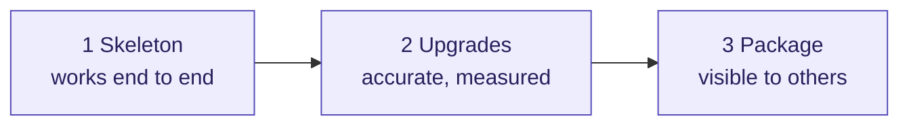
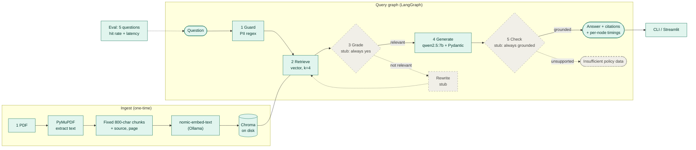
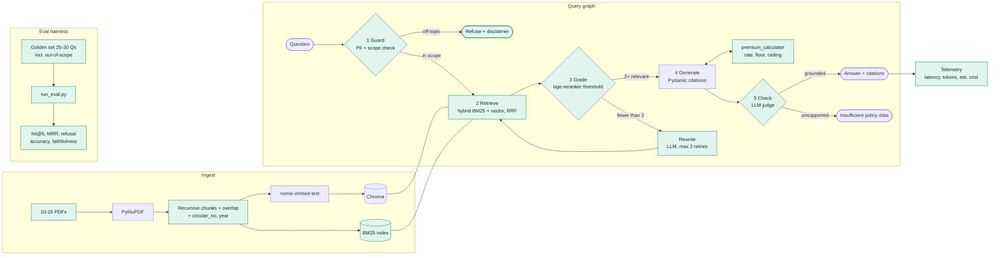
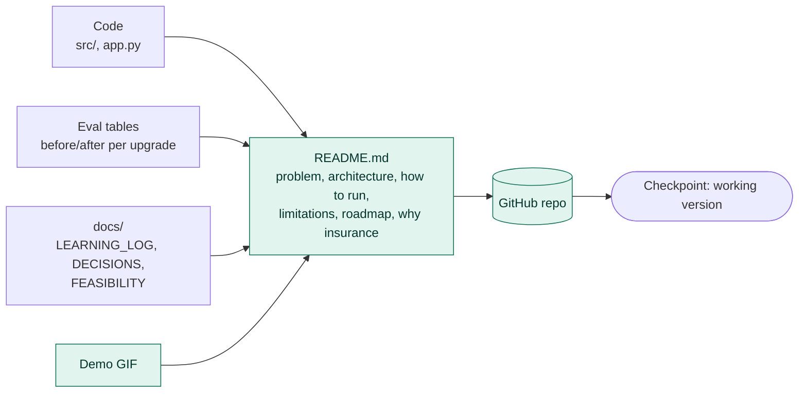

# PhilHealth Policy RAG Agent: architecture by stage (Phase 1)

Each diagram shows the system at the end of that stage.

**Legend:** green = new in this stage · grey dashed = stub (placeholder) · plain = unchanged from earlier stages

## Progression overview

## Stage 1: Walking skeleton

New: every node exists and is wired. Only Guard, Retrieve and Generate do real work.

## Stage 2: Upgrade loop

New: every stub replaced by a real component, plus hybrid search, a calculator tool and an eval harness.

## Stage 3: Package

New: the README and the public repo, which pull together the code, results and notes.

